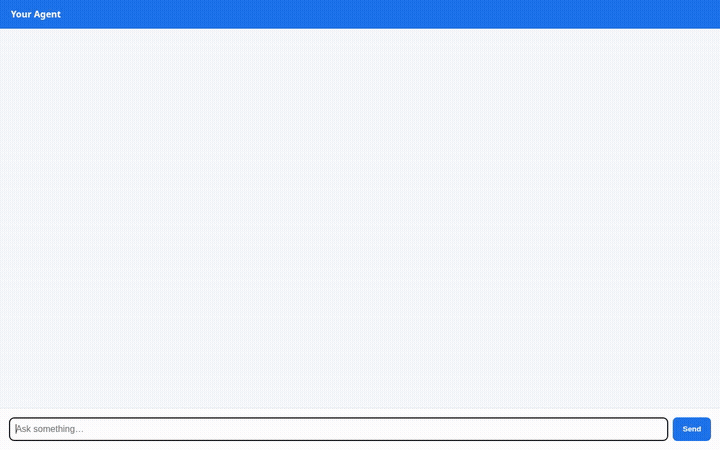

# MeetMind (會議智慧與知識庫特工)

> A conversational meeting intelligence agent and searchable knowledge base powered by Gemini 3.8 Flash, Vertex AI Agent Platform, and Google Cloud services.



---

## Overview

**MeetMind** is an enterprise meeting assistant and knowledge base manager designed to help engineering and product teams organize discussions, track commitments, and visualize outcomes. Built with Google's **Agent Development Kit (ADK)** and deployed via **`agents-cli`**, MeetMind combines multi-turn conversation, cross-session memory, structured database storage, secure sandboxed execution, and multimodal asset generation.

---

## Implemented Capabilities & Google Cloud Services

The following features and cloud services are actively implemented and wired into the codebase (`app/` and `agents-cli-manifest.yaml`):

### 🧠 1. Long-Term Cross-Session Memory
- **Service**: **Vertex AI Memory Bank** (`VertexAiMemoryBankService`)
- **Wiring**: Integrated via `PreloadMemoryTool` before model turns and `generate_memories_callback` after turns.
- **Functionality**: Automatically remembers user roles, discussion preferences, recurring team member identities, and project contexts across independent conversation sessions.

### 🗄️ 2. Meeting & Action Item Database
- **Service**: **Google Cloud Firestore** (Native Mode)
- **Wiring**: Implemented in [`app/firestore_tools.py`](app/firestore_tools.py) using the Google Cloud Firestore SDK.
- **Functionality**:
  - `list_meetings`: Lists historical meeting minutes, topics, dates, and attendee rosters.
  - `get_meeting_details`: Retrieves full transcripts, discussion records, and decision logs by meeting ID.
  - `search_meetings`: Queries meeting notes and decisions by keyword.
  - `save_meeting`: Inserts new structured meeting minutes and associated action items.
  - `list_action_items`: Filters tasks by owner, status (`Pending`, `In Progress`, `Completed`), or meeting.
  - `update_action_item_status`: Updates task completion status directly in Firestore.

### 🐍 3. Secure Python Code Sandbox
- **Service**: **Vertex AI Agent Engine Sandbox** (`AgentEngineSandboxCodeExecutor`)
- **Wiring**: Configured directly on the root ADK agent.
- **Functionality**: Executes dynamic Python code in an isolated container to calculate sprint velocities, task completion percentages, date math, and meeting time analytics.

### 🎨 4. Visual Diagram & Mind Map Generation
- **Service**: **Gemini Image Generation** (`gemini-3.1-flash-lite-image`) & **Google Cloud Storage**
- **Wiring**: Implemented in [`app/image_tools.py`](app/image_tools.py).
- **Functionality**:
  - Generates visual mind maps, concept diagrams, and milestone celebration banners.
  - Saves the image part to the ADK session artifact store via `tool_context.save_artifact`.
  - Streams image bytes directly to a public Cloud Storage bucket without local disk persistence.
  - Returns a public HTTPS storage URL for display.

### 🎬 5. Short Video Highlight Generation
- **Service**: **Google Omni Model** (`gemini-omni-flash-preview`) via **Interactions API** & **Google Cloud Storage**
- **Wiring**: Implemented in [`app/video_tools.py`](app/video_tools.py) targeting the `global` region.
- **Functionality**:
  - Generates short animated recap videos and milestone celebration clips.
  - Saves the MP4 video to session artifacts via `tool_context.save_artifact`.
  - Directly streams video bytes to a public Cloud Storage bucket and returns the public HTTPS URL.

### 🃏 6. Rich UI Rendering (A2UI)
- **Framework**: **A2UI** (Agent-to-User Interface) v0.8 with Basic Catalog
- **Wiring**: Implemented in [`app/a2ui_utils.py`](app/a2ui_utils.py) and registered as an `after_model_callback`.
- **Functionality**:
  - Transforms structured agent responses into clean, responsive A2UI surfaces (`Card`, `Column`, `Row`, `Text`, and `Image`).
  - Natively rendered in both the ADK Web playground and the custom chat frontend.

### 🌐 7. Custom Web Chat Frontend & A2A Protocol
- **Framework**: FastAPI proxy + vanilla HTML/CSS/JS frontend
- **Wiring**: Located in [`frontend/`](frontend/).
- **Functionality**:
  - Speaks the standard **A2A (Agent-to-Agent)** protocol via `a2a-sdk`.
  - Proxies user chat queries to the deployed Agent Runtime.
  - Includes a built-in A2UI card renderer.

### 📅 8. External Utility Tools
- **Service**: **Nager.Date Public Holiday API**
- **Wiring**: Implemented in [`app/calendar_tools.py`](app/calendar_tools.py).
- **Functionality**: Queries country-specific public holidays to assist team leads in avoiding holidays when assigning action item deadlines.

---

## Planned Features (Roadmap / Not Yet Implemented)

The following items were envisioned in the initial project brief but have not yet been implemented in the codebase:
- **Direct Multimodal Audio Ingestion Pipeline**: Ingestion of raw `.mp3` or `.wav` audio files directly into Gemini audio processing (current implementation operates on structured text summaries and transcripts).
- **Cloud Trace Instrumentation**: Distributed tracing for measuring end-to-end tool call latency across external APIs.

---

## Repository Structure

```
.
├── app/
│   ├── agent.py              # Root ADK agent definition and tool registration
│   ├── a2ui_utils.py         # A2UI schema manager and response transformation callback
│   ├── firestore_tools.py    # Firestore queries for meetings and action items
│   ├── image_tools.py        # Gemini image generation & Cloud Storage upload
│   ├── video_tools.py        # Omni video generation via Interactions API & GCS
│   └── calendar_tools.py     # Public holiday lookup tool
├── frontend/
│   ├── main.py               # FastAPI proxy communicating over A2A protocol
│   ├── static/               # Chat UI and built-in A2UI card renderer
│   ├── requirements.txt      # Frontend Python dependencies
│   └── Dockerfile            # Container definition for Cloud Run
├── agents-cli-manifest.yaml  # agents-cli project specification
├── pyproject.toml            # Agent dependencies and ADK configuration
└── demo.gif                  # Screen recording of the live agent in action
```

---

## Local Setup & Run Guide

### Prerequisites
- Python 3.11 or higher
- [uv](https://docs.astral.sh/uv/) (fast Python package manager)
- [Google Cloud SDK](https://cloud.google.com/sdk) (`gcloud`) installed and authenticated

### 1. Authenticate with Google Cloud
Ensure your local environment has credentials for Vertex AI, Firestore, and Cloud Storage:
```bash
gcloud auth login
gcloud auth application-default login
gcloud config set project <YOUR_GCP_PROJECT_ID>
```

### 2. Run the Agent in ADK Web Playground
To run and test the agent logic with the interactive ADK playground:
```bash
# From the project root
uv sync
uv run adk web . --port 8000 --reload_agents
```
Open a browser to port 8000 on your machine to interact with the agent and inspect session artifacts.

### 3. Run the Custom Chat Frontend
To run the lightweight chat interface locally:
```bash
cd frontend
python3 -m venv .venv
source .venv/bin/activate
pip install -r requirements.txt

# Provide your deployed Agent Engine resource name
export AGENT_ENGINE_RESOURCE_NAME="projects/<PROJECT_NUMBER>/locations/<LOCATION>/reasoningEngines/<ENGINE_ID>"
export AGENT_DIRECTORY="app"
export PORT=8080

python main.py
```
Open a browser to port 8080 to test the custom chat interface with native A2UI card rendering.

---

## License
Apache-2.0
